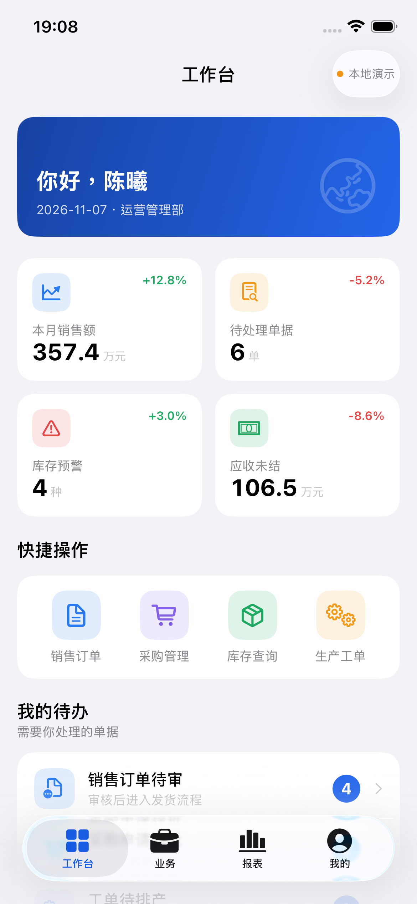
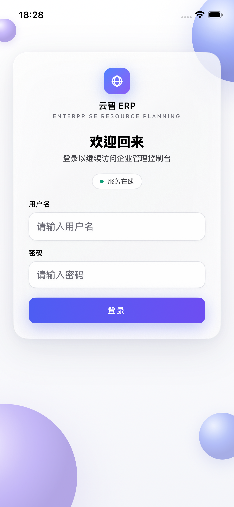

# 云智 ERP（YunZhi ERP）

一个**零第三方依赖**的轻量 ERP 演示系统：Python 标准库实现的 REST 服务端 + 网页管理台 + SwiftUI iOS 客户端，三端共用同一套 API。



## 功能特性

- **三端一套 API**：服务端（Python 3 标准库，无 pip 依赖）→ 网页管理台（原生 HTML/CSS/JS）→ iOS App（SwiftUI）
- **业务模块**：仪表盘、销售订单、采购订单、库存（入库/出库查找/库存流水）、生产工单、应收应付发票、往来单位（客户/供应商）、报表
- **账号体系**：PBKDF2-SHA256 口令散列、Bearer Token 会话、管理员/普通用户两级角色、修改密码、账号启停
- **仓储出库**：出库登记（校验库存 → 扣减 → 写 `CK-YYYY-NNNN` 流水）、多维查找（关键词/SKU/仓库/操作员/日期区间）、CSV 导出
- **数据持久化**：JSON 文件落盘，开箱即用，不需要数据库
- **iOS 端支持双数据源**：云端 REST / 本地 Mock（离线演示），登录页为白底磨砂玻璃设计

## 目录结构

```
yunzhi-erp/
├── ERPServer/                 # 服务端 + 网页管理台
│   ├── app/
│   │   ├── server.py          # HTTP 服务 + 全部 REST 端点（含 /health /v1/meta）
│   │   ├── auth.py            # 用户/会话/密码散列
│   │   ├── seed.py            # 演示种子数据
│   │   └── web/               # 网页管理台（index.html 管理台 + login.html 登录页）
│   ├── config.json            # 端口 / 数据目录等配置
│   ├── start.bat              # Windows 前台启动
│   ├── deploy.ps1             # Windows 一键部署（注册开机自启服务）
│   └── tools/                 # 登录页 3D 地球背景生成脚本（可选）
├── ERPiOS/                    # SwiftUI iOS 客户端
│   ├── ERPiOS/                # 源码（Domain / Data / Features / Navigation / Core / App）
│   ├── ERPiOS.xcodeproj/      # Xcode 工程
│   ├── gen_project.py         # 工程文件生成脚本（重建 pbxproj 用）
│   └── install_device.sh      # 真机签名安装一键脚本
└── docs/screenshots/          # 截图
```

## 快速开始（服务端）

要求 Python 3.9+，无需安装任何第三方库。

```bash
cd ERPServer
python app/server.py          # 默认监听 http://127.0.0.1:8080
python app/server.py --demo   # 启动时注入演示数据
python app/server.py --reset  # 清空数据重新开始
python app/server.py --port 9000 --host 0.0.0.0
```

- 首次启动会自动创建管理员账号 **admin**，初始密码随机生成并写入 `data/initial-admin.txt`，登录后请立即修改。
- 浏览器打开 `http://127.0.0.1:8080` 即进入网页管理台。
- `config.json` 可配置端口、绑定地址、数据目录、会话时长；`--token` 可覆盖 Bearer Token。

### REST API 概览

- `GET /health`：健康检查；`GET /v1/meta`：全部端点清单
- `POST /v1/auth/login`、`GET /v1/auth/me`、`POST /v1/auth/change-password`
- `GET/POST/PATCH /v1/sales`、`/v1/purchases`、`/v1/inventory`、`/v1/production`、`/v1/invoices`、`/v1/customers`、`/v1/suppliers`、`/v1/products`
- `GET /v1/inventory/outbound/search`（出库多维查找）、`POST /v1/inventory/outbound`（出库登记）
- `GET /v1/dashboard/summary`、`GET /v1/reports/overview`

## 快速开始（iOS）

1. 用 Xcode 打开 `ERPiOS/ERPiOS.xcodeproj`；
2. 在 **Signing & Capabilities** 里选择你自己的 Apple ID 团队（免费个人团队即可，仓库里未内置签名信息）；
3. 先把 `ERPServer` 跑起来（或点「我的 → 数据源」把服务器地址改成本机局域网 IP），选真机/模拟器直接 Run。

命令行真机安装：

```bash
cd ERPiOS
./install_device.sh <设备UDID>     # xcrun devicectl list devices 查看
```



## 技术要点

- **服务端**：`http.server.ThreadingHTTPServer` + 一个 `dispatch(method, segs, query, body, token)` 路由函数；JSON 落盘持久化；所有业务校验集中在端点内，统一 `ApiError` 异常。
- **iOS**：`Domain(Models/Repositories 协议) → Data(Remote/Mock 双实现) → Features(各业务页面) → Navigation(AppRoute)`，`RepositoryProvider` 在云端/本地两套实现间切换。
- **登录页**：白底磨砂玻璃（iOS 用 `.ultraThinMaterial` 低不透明度叠加白渐变；Web 用 `backdrop-filter`），背景装饰球为多条不同周期正弦波叠加的有机漂移，均尊重系统「减弱动态效果」。

## 安全说明

- 本项目为演示/学习用途：数据明文存于 JSON，会话 Token 存本地，请勿直接用于生产。
- 部署到公网时请务必：改掉初始密码、用反向代理加 HTTPS、限制端口暴露范围。

## License

[MIT](LICENSE)
